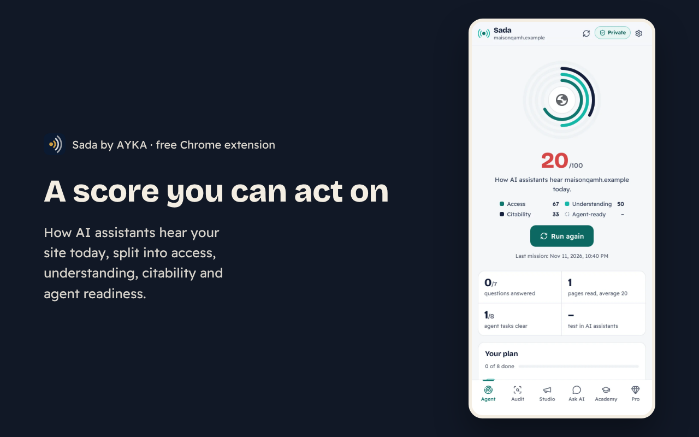

# Sada by AYKA: see your website the way AI assistants see it

Sada is a free Chrome extension. One click sends an agent through the page you are on: it reads it the way ChatGPT,
Gemini and Perplexity do, predicts the questions your customers ask them, finds the answers your site is missing and
builds your fix pack. Everything runs on your computer: no account, no API key, nothing sent. Free, with public source code.

**[⬇ Download Sada (Sada-by-AYKA.zip)](https://github.com/ayka-technologies/sada/releases/latest/download/Sada-by-AYKA.zip)** ·
[Website](https://getayka.com/sada/) · [Privacy](https://getayka.com/sada/privacy/) · Free GEO course:
[getayka.com/academy](https://getayka.com/academy/)

## Install (2 minutes)

Step-by-step with pictures: **[getayka.com/sada/#install](https://getayka.com/sada/#install)**

1. Download **Sada-by-AYKA.zip** (link above). Right-click it → **Extract All** → **Extract**. Keep the new `Sada-by-AYKA` folder.
2. In Chrome, open `chrome://extensions` and switch on **Developer mode** (top right).
3. Click **Load unpacked** and choose the `Sada-by-AYKA` folder (the one that contains `manifest.json`).
4. Click the puzzle icon in the toolbar and pin **Sada**. Open your website and click the Sada icon.

Works in Chrome 116+, Edge, Brave and Opera (same steps; in Edge the page is `edge://extensions`).

**Update:** download the new Sada-by-AYKA.zip, unzip it over the same folder, then click the reload arrow on Sada in
`chrome://extensions`. Your results and settings stay.

## Installation (français)

1. Téléchargez **Sada-by-AYKA.zip** (lien ci-dessus) : clic droit → **Extraire tout** → **Extraire**. Gardez le dossier `Sada-by-AYKA`. Guide illustré : [getayka.com/fr/sada/#install](https://getayka.com/fr/sada/#install)
2. Dans Chrome, ouvrez `chrome://extensions` et activez le **Mode développeur** (en haut à droite).
3. Cliquez sur **Charger l'extension non empaquetée** et choisissez le dossier `Sada-by-AYKA` (celui qui contient `manifest.json`).
4. Épinglez **Sada** via l'icône puzzle, ouvrez votre site et cliquez sur l'icône Sada.

**Mise à jour :** téléchargez le nouveau Sada-by-AYKA.zip, décompressez-le dans le même dossier, puis cliquez sur la flèche de
rechargement de Sada dans `chrome://extensions`.

## التثبيت (العربية)

1. نزّل **Sada-by-AYKA.zip** (الرابط أعلاه)، ثم بزر الفأرة اليمين: **استخراج الكل** ← **استخراج**. احتفظ بالمجلد `Sada-by-AYKA`. دليل مصوّر: [getayka.com/ar/sada/#install](https://getayka.com/ar/sada/#install)
2. في Chrome افتح `chrome://extensions` وفعّل **وضع المطوّر** (أعلى اليمين).
3. اضغط **تحميل إضافة غير مضغوطة** واختر المجلد `Sada-by-AYKA` (الذي يحتوي على `manifest.json`).
4. ثبّت **صدى** من أيقونة القطعة في شريط الأدوات، وافتح موقعك، واضغط أيقونة صدى.

**التحديث:** نزّل Sada-by-AYKA.zip الجديد وفكّ ضغطه في المجلد نفسه، ثم اضغط سهم إعادة التحميل على صدى في `chrome://extensions`.

## Privacy

Sada has no account, no analytics and no server. What it reads is analysed in your browser and never sent to AYKA
TECHNOLOGIES or anyone else. Full policy: https://getayka.com/sada/privacy/

## Licence

Sada's code is public under the **Functional Source License (FSL-1.1-ALv2)**, see [LICENSE.md](LICENSE.md):
- free to use for anything, at work too, including professional services for your clients;
- free to read, change and share, as long as the licence comes along;
- not allowed: offering it, or a copy of it, as a competing product or service;
- each version becomes **Apache-2.0 two years** after its release. Version 0.8.4 and earlier remain Apache-2.0.

**Course text (AYKA Academy lessons and quizzes in `lib/academy`):** you may quote it with credit and a link to
[getayka.com/academy](https://getayka.com/academy/); don't republish it as your own course, in whole or in large parts.

The names Sada and AYKA and their logos are not part of the licence: see [TRADEMARKS.md](TRADEMARKS.md). Fonts and
icons keep their own licences: [THIRD-PARTY-NOTICES.md](THIRD-PARTY-NOTICES.md).

**For agencies:** want Sada under your own brand for your clients? That's a partnership:
[hello@getayka.com](mailto:hello@getayka.com).

Made by AYKA TECHNOLOGIES · [getayka.com](https://getayka.com) · hello@getayka.com
